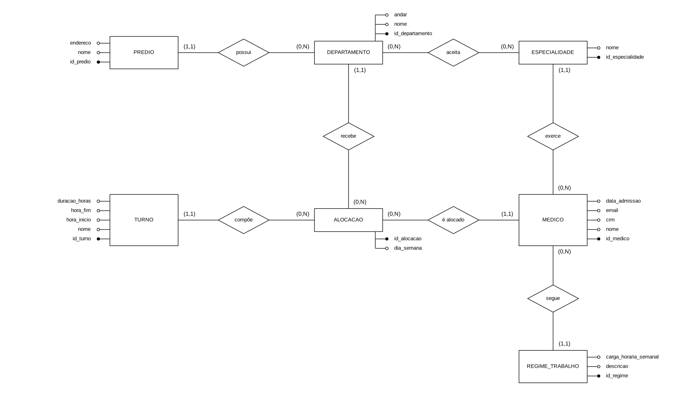
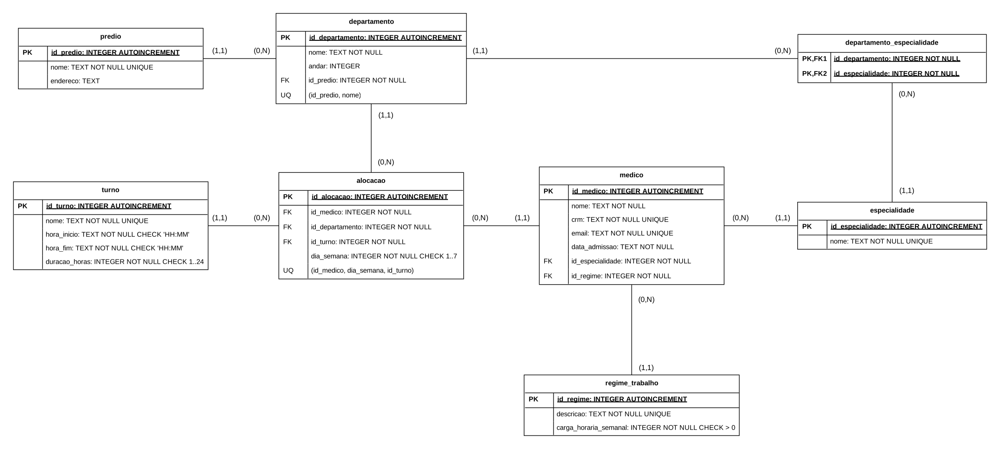

<p align="center">
  
</p>

# 🏥 EscalaMed - Sistema de Escala Médica


## 📱 Sobre o Projeto

O **EscalaMed** é um sistema projetado para solucionar um problema crítico de gestão hospitalar: a descentralização e a falta de visibilidade na escala de médicos de um grande hospital. Atualmente, a escala é feita em planilhas dispersas, impossibilitando localizar os médicos de prontidão de forma ágil. 

Com base num cadastro pré-existente de médicos em SQLite, o projeto estende a base de dados para modelar e automatizar a escala semanal de múltiplos prédios e departamentos (UTI, Ambulatórios, Centro Cirúrgico, Pronto Atendimento), integrando restrições de carga horária e regras de compatibilidade de especialidades.

**🎯 Pergunta Central**  
*Em qual prédio e departamento o médico X está no dia Y, turno Z?*

## 👨‍💻 Equipe de Desenvolvimento

Esta solução foi modelada e implementada pelos seguintes engenheiros:

* 👤 **Bruno Simcka Mosteck** — [GitHub](https://github.com/BruMosteck)
* 👤 **Miguel Freitas Vieira** — [GitHub](https://github.com/DevFreitasMiguel)
* 👤 **Henrique Pinheiro Lima** — [GitHub](https://github.com/PinheiroLim)

**Disciplina:** Banco de Dados | **Professor:** Stelvio Barboza

---

## 🏗️ Estrutura do Projeto

O repositório está organizado de forma modular nas seguintes pastas:

* **`database/base/`**: Banco fornecido (`hospital.sqlite`, com as tabelas `medico`, `especialidade` e `regime_trabalho` já povoadas). Os scripts rodam sobre uma **cópia** dele. A subpasta `schema/` traz a estrutura dessas 3 tabelas apenas como referência (**não executar**).
* **`database/ddl/`**: Scripts de criação da modelagem atualizada (Prédio, Departamento, Turno, etc.).
* **`database/dml/`**: Scripts de inserção de dados para povoamento inicial do banco.
* **`database/queries/`**: Consultas SQL para teste e validação das regras operacionais.
* **`docs/diagramas/`**: Modelos visuais (Conceitual e Lógico) da arquitetura do banco.

## 📊 Modelagem de Dados

A arquitetura do banco de dados foi expandida para incluir um controle físico e temporal mais detalhado:
* **Prédio & Departamento:** 3 prédios (Blocos A, B e C) e 9 departamentos (UTI, Pronto Atendimento, Centro Cirúrgico, ambulatórios, Maternidade, Pediatria e Diagnóstico por Imagem), com `endereco` e `andar`.
* **Turno:** Validação rigorosa de horários no formato 24h (`HH:MM`, de 00:00 a 23:59) com `GLOB`, e coluna `duracao_horas` armazenada, porque o turno da noite atravessa a meia-noite (`19:00` -> `07:00` = `12` h).
* **Alocação:** Mapeamento central da escala por `dia_semana` (1 a 7) e travas lógicas contra conflitos.

### Modelo Conceitual
<details>
  <summary><b>Expandir / retrair o diagrama</b></summary>
  <br>
  
</details>

<br>

### Modelo Lógico
<details>
  <summary><b>Expandir / retrair o diagrama</b></summary>
  <br>
  
</details>

## ⚙️ Regras de Negócio e Restrições (Constraints)

| Regra | Descrição | Implementação SQL |
| :--- | :--- | :--- |
| **RN01** | Prevenção de conflito de horários (mesmo médico/dia/turno). | `UNIQUE (id_medico, dia_semana, id_turno)` |
| **RN02** | Especialidade compatível com o departamento alocado. | Validado via `queries/q4` (deve retornar vazio) |
| **RN03** | A soma das horas alocadas não pode passar da carga semanal do regime. | Validado via `queries/q5` |
| **RN04** | Dia da semana válido: 1 (segunda) a 7 (domingo), padrão ISO 8601. | `CHECK (dia_semana BETWEEN 1 AND 7)` |
| **RN05** | Todo departamento pertence a exatamente um prédio. | `id_predio INTEGER NOT NULL REFERENCES predio` |
| **RN06** | Não é possível alocar médico, departamento ou turno inexistente. | `FOREIGN KEY` (`REFERENCES`) + `PRAGMA foreign_keys = ON` |

## 📐 Decisões de Modelagem

* **`departamento_especialidade`** resolve o relacionamento N:N; a chave primária é composta pelas duas FKs (`id_departamento`, `id_especialidade`).
* **`turno.duracao_horas`** é armazenada em vez de calculada, pois o turno da noite cruza a meia-noite e a subtração dos horários daria resultado errado. Isso simplifica a validação da RN03.
* **Horários** em `TEXT` no formato ISO `HH:MM` (o SQLite não tem tipo `TIME`), com `CHECK` que exige zero à esquerda, o que garante a ordenação correta.
* **Chaves estrangeiras** sem `ON DELETE` / `ON UPDATE`, no mesmo estilo das tabelas fornecidas. O padrão do SQLite (`NO ACTION`) já impede apagar um registro que ainda é referenciado.
* **Tabelas fornecidas** (`medico`, `especialidade`, `regime_trabalho`) não foram alteradas, como exige o enunciado.
* **Cardinalidades** `(0,N)` nos lados que o banco não consegue obrigar (prédio sem departamento, departamento sem especialidade), refletindo o que o SQL de fato garante.

## 🚀 Como Executar

> Sempre rode sobre uma **cópia limpa** do banco fornecido, nunca sobre o original.

1. Copie `database/base/hospital.sqlite` para a raiz do projeto (ex.: `escala.sqlite`).
2. No **VSCodium**, com a extensão **SQLite (alexcvzz)**, use `SQLite: Open Database` e selecione a cópia.
3. Execute, **na ordem numérica**, com `SQLite: Run Query`: primeiro a pasta `ddl/` (01 a 05), depois a pasta `dml/` (01 a 05) e por fim a pasta `queries/` (q1 a q6).
4. Todo script começa com `PRAGMA foreign_keys = ON;`, necessário para o SQLite aplicar as chaves estrangeiras.
5. Use a extensão **SQLite Viewer** para inspecionar os dados visualmente.

**Alternativa pelo terminal (sqlite3):**

```bash
cp database/base/hospital.sqlite escala.sqlite
for f in database/ddl/*.sql database/dml/*.sql; do sqlite3 escala.sqlite < "$f"; done
sqlite3 -header-column escala.sqlite < database/queries/q1_escala_medico.sql
